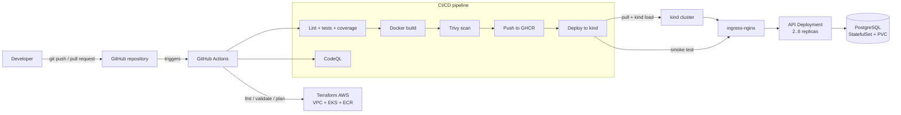
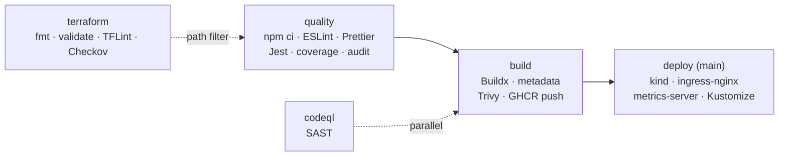
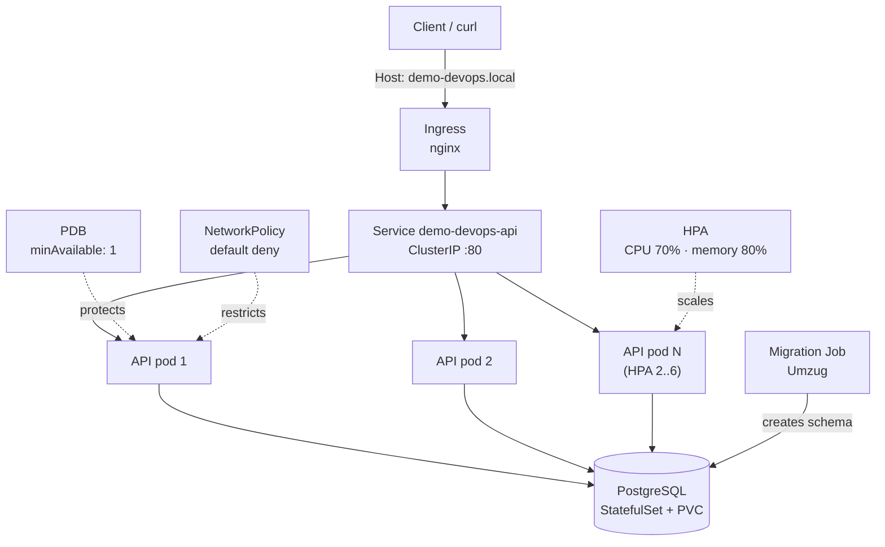
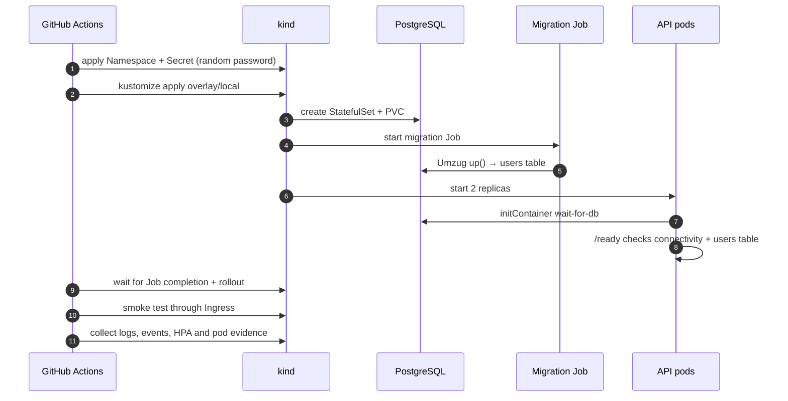

# DevOps Technical Test — Node.js API on Kubernetes

[](https://github.com/lgochoa/devsu-devops-challenge/actions/workflows/ci-cd.yml)
[](https://github.com/lgochoa/devsu-devops-challenge/actions/workflows/terraform.yml)

Technical test for a DevOps position. The repository takes the **`devsu-demo-devops-nodejs`**
starter application and turns it into a containerized, tested and observable service deployed to
Kubernetes by a CI/CD pipeline.

- **Repository:** <https://github.com/lgochoa/devsu-devops-challenge>
- **Application:** Node.js 20 + Express + Sequelize
- **Runtime target:** Docker + Kubernetes (kind locally/in CI, portable to EKS/AKS/GKE)

---

## 1. Executive summary

| Requirement                   | Implementation                                                                                           | Status                    |
| ----------------------------- | -------------------------------------------------------------------------------------------------------- | ------------------------- |
| Dockerize the application     | Multi-stage `Dockerfile`, non-root user, `dumb-init`, healthcheck, env vars, configurable port           | ✅                        |
| Pipeline as code              | GitHub Actions: build, lint, unit tests, coverage, CodeQL, Trivy, Docker build & push, Kubernetes deploy | ✅                        |
| Static code analysis          | ESLint + CodeQL (`security-extended`)                                                                    | ✅                        |
| Code coverage                 | Jest coverage with thresholds, HTML/LCOV/JSON reports and job summary                                    | ✅                        |
| Build and push image          | Docker Buildx + GHCR, immutable `sha-<commit>` tags                                                      | ✅                        |
| Vulnerability scan            | Trivy image scan with SARIF upload to GitHub Security                                                    | ✅                        |
| Kubernetes deployment         | kind cluster in CI: 2+ replicas, HPA, PDB, ConfigMap, Secret, Ingress, NetworkPolicy, probes, resources  | ✅                        |
| Deploy from the pipeline      | `deploy` job applies Kustomize manifests, runs migrations, waits for rollout and executes smoke tests    | ✅                        |
| Documentation and diagrams    | This README + ADRs + Mermaid diagrams + evidence artifacts                                               | ✅                        |
| Public endpoint               | Not available: no public cloud account was provided                                                      | ⚠️ N/A                    |
| IaC in a public cloud (extra) | Terraform module for AWS EKS + ECR, validated in CI                                                      | ⚠️ Validated, not applied |
| Public pipeline evidence      | GitHub Actions runs and artifacts                                                                        | ✅                        |

The main engineering decision was to **replace SQLite with PostgreSQL** and **replace
`sequelize.sync({ force: true })` with versioned migrations**, because the original design cannot
run safely with more than one replica. See [ADR 0002](docs/adr/0002-postgresql-and-migrations.md).

---

## 2. Architecture



### 2.1 Pipeline stages



### 2.2 Kubernetes topology



### 2.3 Deployment sequence



---

## 3. Repository structure

```text
.
├── app.js                     # Express app (routes, health, error handling)
├── index.js                   # HTTP server + graceful shutdown
├── config.js                  # Environment configuration and validation
├── users/                     # Controller, model and router
├── shared/                    # Database, validation middleware and schemas
├── migrations/                # Versioned Umzug migrations
├── scripts/
│   ├── migrate.js             # Runs pending migrations
│   ├── migrate-down.js        # Rolls back the last migration
│   ├── wait-for-db.js         # initContainer database wait
│   ├── smoke-test.sh          # HTTP contract checks through the ingress
│   ├── collect-evidence.sh    # Captures kubectl state as an artifact
│   └── coverage-summary.js    # Markdown coverage table for the job summary
├── tests/                     # Jest + Supertest test suite
├── Dockerfile                 # Multi-stage production image
├── docker-compose.yml         # Local app + PostgreSQL
├── k8s/
│   ├── base/                  # Namespace, ConfigMap, Secret example, Deployment, HPA, PDB, NetworkPolicy
│   └── overlays/
│       ├── local/             # kind/minikube overlay
│       └── production/        # 3 replicas, TLS and production hostname
├── terraform/aws/             # EKS + ECR module (extra credit)
├── .github/
│   ├── workflows/ci-cd.yml    # Main pipeline
│   ├── workflows/terraform.yml
│   ├── kind-config.yaml
│   └── dependabot.yml
├── docs/
│   ├── adr/                   # Architecture Decision Records
│   └── evidence/              # Pipeline artifacts and screenshots
└── README.md
```

---

## 4. Application

### 4.1 Endpoints

| Method | Path             | Description                                             | Success                          |
| ------ | ---------------- | ------------------------------------------------------- | -------------------------------- |
| `GET`  | `/health`        | Liveness probe; process is alive                        | `200 {"status":"ok"}`            |
| `GET`  | `/ready`         | Readiness probe; database reachable and schema migrated | `200 {"status":"ready"}` / `503` |
| `GET`  | `/api/users`     | List users                                              | `200`                            |
| `GET`  | `/api/users/:id` | Get one user                                            | `200` / `404` / `400`            |
| `POST` | `/api/users`     | Create a user (`dni`, `name`)                           | `201` / `400`                    |

### 4.2 Environment variables

| Variable      | Default        | Description                                |
| ------------- | -------------- | ------------------------------------------ |
| `NODE_ENV`    | `development`  | Runtime environment                        |
| `PORT`        | `8000`         | HTTP port                                  |
| `HOST`        | `0.0.0.0`      | Bind address                               |
| `APP_VERSION` | `dev`          | Version returned by `/health`              |
| `DB_DIALECT`  | `sqlite`       | `sqlite` or `postgres`                     |
| `DB_STORAGE`  | `./dev.sqlite` | SQLite file (local/tests only)             |
| `DB_HOST`     | `localhost`    | PostgreSQL host                            |
| `DB_PORT`     | `5432`         | PostgreSQL port                            |
| `DB_NAME`     | `devops`       | Database name                              |
| `DB_USER`     | `devops`       | Database user                              |
| `DB_PASSWORD` | `devops`       | Database password (required in production) |
| `DB_SSL`      | `false`        | Enable TLS for managed PostgreSQL          |
| `DB_LOGGING`  | `false`        | Log SQL statements                         |

### 4.3 Local development

```bash
cp .env.example .env
npm ci
npm run migrate
npm start
```

Open <http://localhost:8000/api/users>.

```bash
curl -s http://localhost:8000/health
curl -s http://localhost:8000/ready
curl -s -X POST http://localhost:8000/api/users \
  -H 'Content-Type: application/json' \
  -d '{"dni":"0801199912345","name":"Ada Lovelace"}'
curl -s http://localhost:8000/api/users
```

### 4.4 Tests and quality gates

```bash
npm test              # Jest + Supertest (17 tests)
npm run test:coverage # coverage + thresholds
npm run lint          # ESLint
npm run format:check  # Prettier
```

Local coverage (same suite that runs in CI):

| Metric     | Result |
| ---------- | -----: |
| Statements | 92.20% |
| Branches   | 70.73% |
| Functions  | 92.30% |
| Lines      | 93.24% |

Thresholds are enforced in `package.json`: 80% lines/statements/functions and 60% branches.

### 4.5 Changes made to the starter application

- **PostgreSQL support** through `DB_DIALECT`, with SQLite kept for local tests.
- **Versioned migrations** with Umzug instead of `sequelize.sync({ force: true })`.
- **Health and readiness endpoints**, including a schema check in `/ready`.
- **Graceful shutdown** on `SIGTERM`/`SIGINT` (important for rolling updates).
- **Helmet**, JSON body limit and centralized error handling.
- **Strict validation** with Yup and a unique constraint for duplicate DNIs.
- **17 tests** covering success, validation, duplicate, not-found and database-failure paths.
- **`201 Created`** on user creation (REST-correct; the starter test already expected 201).

---

## 5. Docker

The image is built in two stages:

1. `dependencies`: `node:20.18.0-bookworm-slim` + `npm ci --omit=dev`.
2. `runtime`: same base, `dumb-init`, production dependencies, application code, non-root `node`
   user, `EXPOSE 8000` and a `HEALTHCHECK` against `/health`.

```bash
docker build -t demo-devops-nodejs:local .
docker run --rm -p 8000:8000 \
  -e DB_DIALECT=sqlite \
  -e DB_STORAGE=/tmp/dev.sqlite \
  demo-devops-nodejs:local
```

For PostgreSQL, use Docker Compose:

```bash
docker compose up --build
curl -s http://localhost:8000/health
```

`docker-compose.yml` includes a PostgreSQL healthcheck, a migration step before the app starts, a
read-only root filesystem, a `tmpfs` for `/tmp`, `no-new-privileges` and the non-root user.

**Image security choices**

- No build tools, dev dependencies, tests or documentation in the final image.
- Runs as UID/GID 1000 (`node`), never as root.
- `dumb-init` as PID 1 to reap zombies and forward signals.
- `HEALTHCHECK` uses Node's built-in `fetch`, so no extra package is needed.
- Kubernetes runs it with a read-only root filesystem, all capabilities dropped and
  `seccompProfile: RuntimeDefault`.

---

## 6. CI/CD pipeline

Workflow: [`.github/workflows/ci-cd.yml`](.github/workflows/ci-cd.yml)

### 6.1 Jobs

| Job               | What it does                                                                                                                                                                | Blocks                |
| ----------------- | --------------------------------------------------------------------------------------------------------------------------------------------------------------------------- | --------------------- |
| `quality`         | `npm ci`, ESLint, Prettier check, Jest + coverage, coverage summary, reports artifact, `npm audit` (informational)                                                          | `build`               |
| `codeql`          | CodeQL `security-extended` analysis, SARIF upload                                                                                                                           | Nothing (parallel)    |
| `build`           | Buildx build, OCI labels, Trivy scan (fails on HIGH/CRITICAL with fixes), SARIF upload, push to GHCR on `main`/tags                                                         | `deploy`              |
| `deploy`          | kind cluster, ingress-nginx, metrics-server, namespace + random DB secret, image pull + `kind load`, Kustomize apply, migration Job, rollout, smoke test, evidence artifact | Nothing (main only)   |
| `terraform`       | `fmt`, `init -backend=false`, `validate`, TFLint, Checkov                                                                                                                   | Nothing (path filter) |
| `plan` (optional) | `terraform plan` when `ENABLE_AWS_PLAN=true` and AWS secrets exist                                                                                                          | Nothing               |

### 6.2 Triggers

- `push` to `main`: full pipeline including deploy.
- `push` of a `v*.*.*` tag: build, scan and push a semver tag (no deploy).
- `pull_request` to `main`: quality, CodeQL and image build/scan; no push and no deploy.
- `workflow_dispatch`: manual run.

### 6.3 Image tags

`docker/metadata-action` produces:

- `sha-<full-commit-sha>` — immutable, used by the deploy job.
- `main` — branch tag.
- `vX.Y.Z` — semver tag on releases.
- `latest` — only on `main`.

### 6.4 Security and supply chain

- **CodeQL** (`security-extended`) uploads results to the Security tab.
- **Trivy** scans the built image and fails on fixed HIGH/CRITICAL vulnerabilities; results are
  uploaded as SARIF.
- **`npm audit --omit=dev`** runs as an informational gate.
- **Dependabot** updates npm, GitHub Actions, Docker and Terraform dependencies weekly.
- **Least privilege**: workflow-level `contents: read`; jobs request only the permissions they need.
- **Concurrency**: in-progress runs for the same ref are cancelled.
- **No secrets in Git**: the database password is generated at deploy time with `openssl rand`.

### 6.5 Evidence

Every run produces:

- **Public run URL:** `https://github.com/lgochoa/devsu-devops-challenge/actions`
- **`coverage-report` artifact:** coverage HTML/LCOV/JSON + JUnit XML.
- **`k8s-evidence` artifact:** smoke test, HPA, pods, ingress, PDB, NetworkPolicies, logs and events.
- **Job summary:** coverage table and Kubernetes deployment summary.
- **Security tab:** CodeQL and Trivy SARIF results.

Selected evidence is also documented in [`docs/evidence/`](docs/evidence/).

---

## 7. Kubernetes

Manifests live in [`k8s/`](k8s/) and are rendered with Kustomize:

```bash
kubectl kustomize k8s/overlays/local      # render
kubectl apply -k k8s/overlays/local       # apply
```

### 7.1 Resources

| Resource               | File                       | Details                                                                             |
| ---------------------- | -------------------------- | ----------------------------------------------------------------------------------- |
| `Namespace`            | `base/namespace.yaml`      | Pod Security Standards `restricted`                                                 |
| `ConfigMap`            | `base/configmap.yaml`      | Non-secret configuration (`DB_HOST`, `DB_NAME`, `PORT`, ...)                        |
| `Secret` (example)     | `base/secret.example.yaml` | `DB_USER`, `DB_PASSWORD`; real secret created at deploy time                        |
| `ServiceAccount`       | `base/serviceaccount.yaml` | `automountServiceAccountToken: false`                                               |
| `StatefulSet` + `PVC`  | `base/postgres.yaml`       | PostgreSQL 16, 1Gi PVC, `pg_isready` probes                                         |
| `Service` (PostgreSQL) | `base/postgres.yaml`       | ClusterIP `:5432`                                                                   |
| `Deployment`           | `base/app.yaml`            | 2 replicas, rolling update `maxUnavailable: 0`, probes, resources, security context |
| `Service` (API)        | `base/app.yaml`            | ClusterIP `:80` → `:8000`                                                           |
| `Job`                  | `base/migrate-job.yaml`    | Runs `node scripts/migrate.js` before traffic                                       |
| `Ingress`              | `base/ingress.yaml`        | nginx, host `demo-devops.local`, path `/`                                           |
| `HPA`                  | `base/hpa.yaml`            | min 2, max 6, CPU 70%, memory 80%                                                   |
| `PDB`                  | `base/pdb.yaml`            | `minAvailable: 1`                                                                   |
| `NetworkPolicy`        | `base/networkpolicy.yaml`  | Default deny; DNS, ingress-nginx, API→PostgreSQL only                               |

### 7.2 Reliability and scaling

- **2 replicas minimum**, spread across nodes with `topologySpreadConstraints`.
- **HPA** scales 2 → 6 on CPU/memory (production overlay: 3 → 10).
- **Rolling updates** with `maxUnavailable: 0` and `maxSurge: 1`.
- **Startup, readiness and liveness probes**; readiness also verifies the schema.
- **Graceful shutdown**: `preStop` sleep + 30s termination grace period + `SIGTERM` handling.
- **Resource requests/limits** for the app, init container, migration Job and PostgreSQL.
- **PDB** protects availability during voluntary disruptions.

### 7.3 Security

- Namespace enforces **Pod Security Standards `restricted`**.
- Containers run as non-root with `allowPrivilegeEscalation: false`, all capabilities dropped and
  `seccompProfile: RuntimeDefault`.
- App container uses a **read-only root filesystem** with an `emptyDir` mounted at `/tmp`.
- **NetworkPolicies** default-deny ingress and egress; only DNS, ingress-nginx and
  API/migration→PostgreSQL traffic is allowed.
- The ServiceAccount does not mount a token.
- Secrets are not committed; the pipeline generates a random password and creates the Secret.

### 7.4 Database migrations

`scripts/migrate.js` uses **Umzug** with a `SequelizeMeta` table. The pipeline:

1. Applies the namespace and creates the database Secret.
2. Applies the overlay, including the migration Job.
3. Waits for PostgreSQL and for `job/demo-devops-migrate` to complete.
4. Waits for the API rollout.

The API's `/ready` probe also runs `SELECT 1 FROM users LIMIT 1`, so a pod cannot become ready
before the schema exists. This avoids serving traffic during a migration window.

### 7.5 Run it locally with kind

Prerequisites: Docker (or a compatible container runtime), `kind`, `kubectl` and `kustomize`.

```bash
# 1. Cluster with ports 80/443 mapped to the host
kind create cluster --config .github/kind-config.yaml

# 2. Ingress controller
kubectl apply -f https://raw.githubusercontent.com/kubernetes/ingress-nginx/controller-v1.11.3/deploy/static/provider/kind/deploy.yaml
kubectl wait --namespace ingress-nginx \
  --for=condition=ready pod \
  --selector=app.kubernetes.io/component=controller \
  --timeout=240s

# 2b. Storage class for the PostgreSQL PVC (kind does not ship one by default)
kubectl apply -f https://raw.githubusercontent.com/rancher/local-path-provisioner/v0.0.37/deploy/local-path-storage.yaml
kubectl wait --namespace local-path-storage \
  --for=condition=available deployment/local-path-provisioner \
  --timeout=180s
kubectl patch storageclass local-path \
  -p '{"metadata":{"annotations":{"storageclass.kubernetes.io/is-default-class":"true"}}}'

# 3. Namespace and secret
kubectl apply -f k8s/base/namespace.yaml
kubectl -n demo-devops create secret generic demo-devops-db \
  --from-literal=DB_USER=devops \
  --from-literal=DB_PASSWORD="$(openssl rand -hex 16)"

# 4. Build and load the image
docker build -t demo-devops-api:local .
kind load docker-image demo-devops-api:local --name demo-devops

# 5. Point the local overlay to the local image
cd k8s/overlays/local
kustomize edit set image demo-devops-api=demo-devops-api:local
cd ../..

# 6. Deploy
kubectl apply -k k8s/overlays/local
kubectl -n demo-devops rollout status statefulset/demo-devops-postgres --timeout=240s
kubectl -n demo-devops wait --for=condition=complete job/demo-devops-migrate --timeout=180s
kubectl -n demo-devops rollout status deployment/demo-devops-api --timeout=240s

# 7. Test through the ingress
curl -s -H 'Host: demo-devops.local' http://localhost/health
curl -s -H 'Host: demo-devops.local' http://localhost/api/users
bash scripts/smoke-test.sh
```

### 7.6 Run it locally with minikube

```bash
minikube start
eval "$(minikube docker-env)"
docker build -t demo-devops-api:local .

minikube addons enable ingress
kubectl apply -f k8s/base/namespace.yaml
kubectl -n demo-devops create secret generic demo-devops-db \
  --from-literal=DB_USER=devops \
  --from-literal=DB_PASSWORD="$(openssl rand -hex 16)"

cd k8s/overlays/local
kustomize edit set image demo-devops-api=demo-devops-api:local
cd ../..
kubectl apply -k k8s/overlays/local

# Map demo-devops.local to the minikube IP
echo "$(minikube ip) demo-devops.local" | sudo tee -a /etc/hosts
curl -s http://demo-devops.local/health
```

### 7.7 Production overlay

`k8s/overlays/production` sets:

- 3 replicas and HPA max 10.
- Ingress host `demo.example.com` (replace it).
- TLS with secret `demo-devops-tls` (provide it with cert-manager or a managed certificate).

For production, also:

- Use a managed PostgreSQL service (RDS/Cloud SQL/Azure Database) and remove the in-cluster
  StatefulSet, or use an operator with backups and HA.
- Store secrets in External Secrets Operator, Sealed Secrets or the cloud secret manager.
- Add DNS, TLS, WAF/rate limiting and a CDN in front of the ingress.
- Add Prometheus/Grafana/OpenTelemetry and alerting.
- Add image signing (Cosign), SBOM attestations and a policy engine (Kyverno/Gatekeeper).

---

## 8. Terraform (extra credit)

Module: [`terraform/aws/`](terraform/aws/)

It provisions:

- VPC across three AZs with public/private subnets and a single NAT gateway.
- EKS cluster with private worker nodes, managed node group, control-plane logs and 30-day retention.
- ECR repository with scan-on-push, AES256 encryption and a lifecycle policy.
- Outputs: cluster endpoint, CA, ECR URL, account ID, VPC ID and `configure_kubectl`.

```bash
cd terraform/aws
cp terraform.tfvars.example terraform.tfvars
terraform init
terraform validate
terraform plan -out=tfplan
terraform apply tfplan
```

CI validates it on every change under `terraform/**`:

```text
terraform fmt -check -recursive
terraform init -backend=false
terraform validate
tflint --init && tflint --recursive
checkov (soft fail)
```

> **Limitation:** the module was **not applied** because there was no AWS account or credentials.
> It is ready to apply and produces the expected outputs; the CI validation is the available
> evidence. Applying it creates billable resources. See [the Terraform README](terraform/aws/README.md).

---

## 9. Evidence

| Evidence                       | Location                                                             |
| ------------------------------ | -------------------------------------------------------------------- |
| Pipeline runs                  | <https://github.com/lgochoa/devsu-devops-challenge/actions>          |
| CI/CD workflow                 | [`.github/workflows/ci-cd.yml`](.github/workflows/ci-cd.yml)         |
| Terraform workflow             | [`.github/workflows/terraform.yml`](.github/workflows/terraform.yml) |
| Coverage and JUnit reports     | `coverage-report` artifact of each run                               |
| Kubernetes deployment evidence | `k8s-evidence` artifact of each run                                  |
| Security findings              | GitHub Security tab (CodeQL + Trivy SARIF)                           |
| Screenshots                    | [`docs/evidence/`](docs/evidence/)                                   |

The deploy job writes a summary to the run page and captures:

- HTTP smoke test through the ingress (health, readiness, CRUD, duplicates, validation, 404).
- `kubectl get all`, ingress, HPA, PDB, NetworkPolicy, StatefulSet, Job and PVC.
- Deployment description (probes, resources, security context).
- Application logs and namespace events.
- HPA state after an optional `ab` load test.

---

## 10. Architecture decisions

| ADR                                                | Decision                                                                  |
| -------------------------------------------------- | ------------------------------------------------------------------------- |
| [0001](docs/adr/0001-nodejs.md)                    | Use the Node.js starter application                                       |
| [0002](docs/adr/0002-postgresql-and-migrations.md) | PostgreSQL + Umzug migrations instead of SQLite + `sync({ force: true })` |
| [0003](docs/adr/0003-github-actions-ghcr.md)       | GitHub Actions + GHCR                                                     |
| [0004](docs/adr/0004-kubernetes-kind-kustomize.md) | kind in CI + Kustomize overlays                                           |
| [0005](docs/adr/0005-terraform-aws.md)             | Terraform for AWS EKS + ECR (extra credit)                                |
| [0006](docs/adr/0006-security-baseline.md)         | Security baseline                                                         |

---

## 11. Requirements traceability

| Exercise requirement                             | Where                                                                              |
| ------------------------------------------------ | ---------------------------------------------------------------------------------- |
| Dockerize with env vars, user, port, healthcheck | [`Dockerfile`](Dockerfile), [`docker-compose.yml`](docker-compose.yml)             |
| Code build                                       | `build` job in [`ci-cd.yml`](.github/workflows/ci-cd.yml)                          |
| Unit tests                                       | `npm test` in `quality` job; [`tests/`](tests/)                                    |
| Static code analysis                             | ESLint in `quality`; CodeQL job                                                    |
| Code coverage                                    | `npm run test:coverage` + coverage summary + artifact                              |
| Docker build and push                            | Buildx + GHCR in `build` job                                                       |
| Vulnerability scan (optional)                    | Trivy in `build` job                                                               |
| Kubernetes with 2+ replicas and HPA              | [`k8s/base/app.yaml`](k8s/base/app.yaml), [`k8s/base/hpa.yaml`](k8s/base/hpa.yaml) |
| ConfigMaps, Secrets, Ingress                     | [`k8s/base/`](k8s/base/)                                                           |
| Kubernetes deploy from pipeline                  | `deploy` job                                                                       |
| README with diagrams                             | This document + [ADRs](docs/adr/)                                                  |
| Public endpoint                                  | Not applicable (no cloud account)                                                  |
| IaC in public cloud (extra)                      | [`terraform/aws/`](terraform/aws/)                                                 |

---

## 12. Known limitations and next steps

### Limitations

1. **No public endpoint.** No public cloud account or domain was available. The deployment is
   validated on an ephemeral `kind` cluster inside GitHub Actions. The manifests are portable to
   EKS/AKS/GKE.
2. **Terraform not applied.** The AWS module is validated but not deployed, for the same reason.
3. **Docker/minikube not available on the development machine.** The machine lacks admin rights and
   WSL2, so local Docker/minikube could not be used; the pipeline is the validated environment.
4. **Single PostgreSQL replica.** The in-cluster StatefulSet is a demo dependency, not HA. Use a
   managed database in production.
5. **Secrets are generated in CI.** There is no external secret manager in this demo.
6. **No TLS/DNS in the local overlay.** The production overlay has placeholders for both.
7. **No full observability stack.** HPA uses metrics-server; there are no Prometheus, Grafana,
   OpenTelemetry or alerting manifests.
8. **No image signing/SBOM.** Recommended next step: Cosign + Syft/Grype attestations.

### Next steps for production

- Managed PostgreSQL with backups, PITR and multi-AZ.
- External Secrets Operator or cloud secret manager.
- cert-manager + DNS + TLS + WAF/rate limiting.
- Prometheus/Grafana/OpenTelemetry, SLOs and alerts.
- Image signing, SBOM and admission policies (Kyverno/Gatekeeper).
- Multi-environment overlays (`staging`, `production`) with GitOps (Argo CD/Flux).
- Blue/green or canary deployments.

---

## 13. Submission checklist

- [x] Public GitHub repository with all generated files.
- [x] Dockerfile and Docker Compose.
- [x] CI/CD pipeline as code with build, tests, static analysis, coverage, image build/push and
      vulnerability scan.
- [x] Kubernetes deployment with 2+ replicas, HPA, ConfigMap, Secret, Ingress and NetworkPolicy.
- [x] Kubernetes deployment stage in the pipeline with smoke tests.
- [x] README with architecture, pipeline and Kubernetes diagrams.
- [x] ADRs documenting the main decisions.
- [x] Terraform module for AWS (extra credit, validated but not applied).
- [ ] Public endpoint (not possible without a cloud account).
- [ ] ZIP/RAR with all files (generated as a release artifact).
